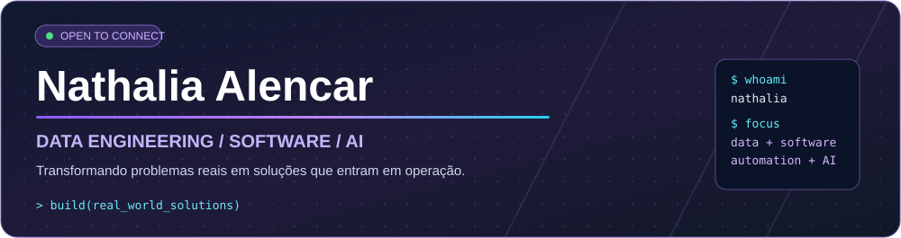
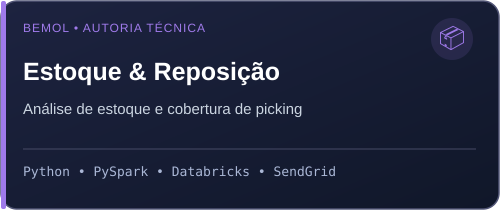
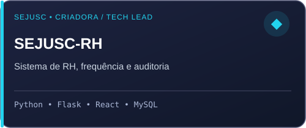
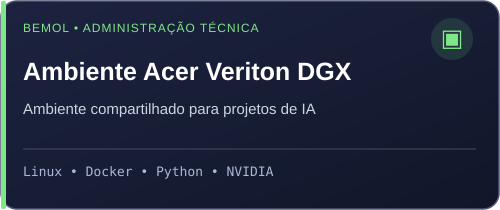
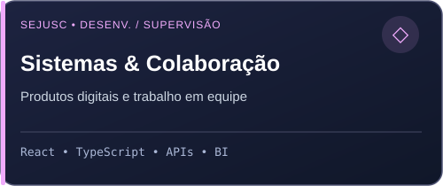

 

---

## `01 / Sobre mim`

Sou **graduanda em Ciência da Computação**, **Trainee de Dados e Projetos Digitais na Bemol** e **cofundadora e CTO da NERVA TECH**.

Minha trajetória une **engenharia e análise de dados, desenvolvimento full-stack, automação, inteligência artificial e liderança técnica**. Gosto de acompanhar um problema desde o entendimento da operação até a implementação de uma solução útil para quem trabalha com ela.

- **Dados e logística:** desenvolvo análises, indicadores e relatórios automatizados com Python, PySpark e Azure Databricks.
- **Software:** crio e evoluo sistemas web e aplicações corporativas, trabalhando com frontend, backend e integração de serviços.
- **IA e ambientes técnicos:** participo de projetos de IA e automação e sou a administradora técnica da **Acer Veriton DGX** utilizada pela minha equipe, em colaboração com a Infraestrutura.
- **Liderança:** atuo em coordenação e supervisão técnica, com atenção à autoria e à contribuição de cada pessoa nos projetos.

> **Meu foco:** construir tecnologia que resolva necessidades concretas — e que continue fazendo sentido depois da entrega.

## `02 / Projetos e experiências em destaque`

<table>
<tr>
<td width="50%"></td>
<td width="50%"></td>
</tr>
<tr>
<td></td>
<td></td>
</tr>
</table>

**Estoque & Reposição:** Desenvolvi individualmente a solução de relatório em produção, que analisa estoque do CD Farma e é consumida pelas equipes do CD Turismo. As regras de negócio foram definidas com apoio das lideranças.

**SEJUSC-RH:** Criei a versão inicial em Python e contribuí para arquitetura, integração e liderança técnica nas evoluções posteriores.

**Acer Veriton DGX:** Administração técnica do ambiente compartilhado da minha equipe, em colaboração com a área de Infraestrutura.

**Sistemas SEJUSC:** Desenvolvimento individual de sistemas, participação em equipes de implementação e supervisão técnica, conforme cada projeto.

> Os projetos corporativos são apresentados pelo contexto e pelas contribuições realizadas, sem disponibilizar sistemas, códigos ou dados internos.
## `03 / Stack principal`

Atualmente, minhas principais frentes técnicas estão concentradas em dados, desenvolvimento de software, automação e infraestrutura para IA.

### Dados & Analytics

### Software & Integrações

### Automação, IA & Infraestrutura

---

## `04 / Minha trajetória`

| Período | Experiência |
|---------|-------------|
| **2026 — atual** | **Bemol** · Trainee de Dados e Projetos Digitais |
| **2026 — atual** | **NERVA TECH** · Cofundadora e CTO |
| **2025 — 2026** | **Manas Tech** · Coordenação de Dados e BI |
| **2024 — 2026** | **SEJUSC** · TI, sistemas, BI e supervisão técnica |
| **2025** | **Maskote Pet Shop** · Desenvolvimento Front-End Mobile |

🎓 **Ciência da Computação — Estácio**  
Conclusão prevista para **2026**.

---

## `05 / Repositórios públicos`

Meus repositórios públicos registram parte da minha evolução técnica por meio de **estudos, experimentos, desafios práticos e projetos acadêmicos**.

### Alguns exemplos
- 🎮 [**FLIPERAMA**](https://github.com/NathyAlencar/FLIPERAMA) — projeto web acadêmico.
- 📊 [**Power BI Analyst — DIO**](https://github.com/NathyAlencar/power_bi_analyst-DIO) — exercícios e estudos em análise de dados.
- 📱 [**Formação React Native Developer — DIO**](https://github.com/NathyAlencar/Formacao-React-Native-Developer-DIO) — estudos de desenvolvimento mobile.
- 🌱 [**Contribuindo em um Projeto Open Source — DIO**](https://github.com/NathyAlencar/dio-lab-open-source) — experiência de colaboração em projeto open source.

➡️ [**Explorar todos os repositórios**](https://github.com/NathyAlencar?tab=repositories)

> Alguns dos projetos mais relevantes da minha trajetória profissional pertencem a contextos corporativos e, por isso, não estão disponíveis publicamente em repositórios abertos.

---

## `06 / Vamos nos conectar?`

Tenho interesse em oportunidades e colaborações envolvendo **dados, software, automação e inteligência artificial**.

